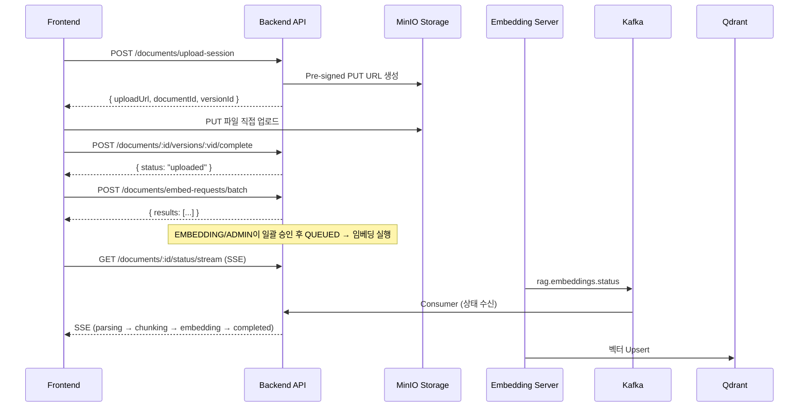
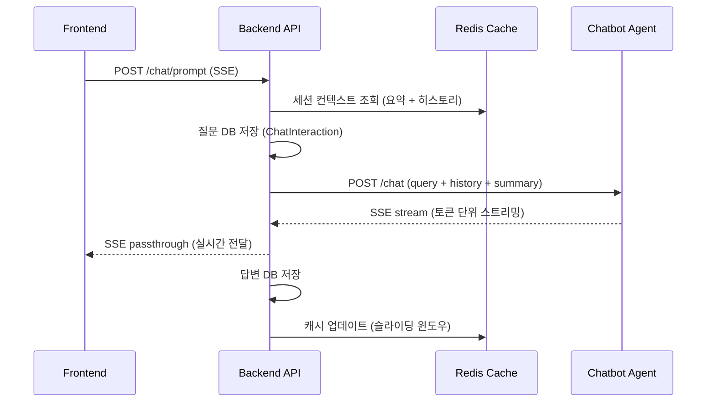
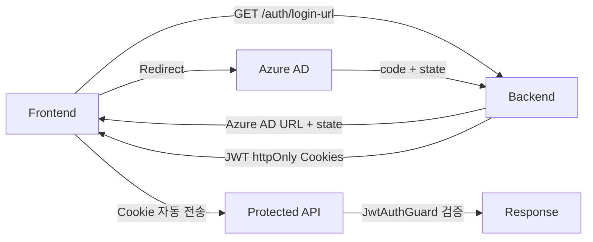

<p align="center">
  
  
  
  
  
  
  
</p>

# AI Gateway Backend API

> DY-OOO AI 솔루션 백엔드 서버 — 문서 RAG 파이프라인, AI 챗봇 게이트웨이, 사용자/권한 관리 API

---

## 목차

1. [서버 개요](#서버-개요)
2. [기술 스택](#기술-스택)
3. [빠른 시작](#빠른-시작)
4. [API 엔드포인트](#api-엔드포인트)
5. [프로젝트 구조](#프로젝트-구조)
6. [워크플로우](#워크플로우)
7. [환경 변수](#환경-변수)
8. [배포/운영](#배포운영)
9. [개발 가이드](#개발-가이드)

---

## 서버 개요

프론트엔드 SPA와 다수의 AI/ML 마이크로서비스(Chatbot Agent, Embedding Server, RAG Pipeline)를 연결하는 **NestJS 하이브리드 애플리케이션**(REST API + Kafka Microservice)입니다.

### 핵심 기능

- **AI 챗봇 게이트웨이** — SSE 스트리밍 기반 실시간 대화, Redis 세션 컨텍스트 관리
- **문서 RAG 파이프라인** — Pre-signed URL 업로드 → MinIO 저장 → 임베딩 서버 → Qdrant 벡터 DB
- **사용자/권한 관리** — Azure AD OAuth 2.0 + JWT httpOnly Cookie 인증
- **관리자 대시보드 API** — 사용자/문서/권한 일괄 관리, Soft/Hard Delete

### API 문서

Swagger UI: `http://localhost:8080/api/api-docs`

---

## 기술 스택

| 분류 | 기술 | 버전 | 설명 |
|------|------|------|------|
| Framework | NestJS | 11.x | TypeScript 서버 프레임워크 |
| Language | TypeScript | 5.7 | 정적 타입 |
| Runtime | Node.js | 24.6 | Alpine 기반 Docker 이미지 |
| Database | PostgreSQL | 15 | 메인 RDBMS (schema: `rag`, 20 테이블) |
| ORM | TypeORM | 0.3.x | Entity 기반 DB 접근 |
| Cache | Redis | — | ioredis 기반 세션/컨텍스트 캐시 |
| Message Queue | Kafka | — | kafkajs, 임베딩 상태 이벤트 처리 |
| Object Storage | MinIO | — | S3 호환 파일 저장소 (bucket: `rag`) |
| Vector DB | Qdrant | — | 벡터 검색 (collection: `rag_chunks_v1`) |
| Auth | Passport + JWT | — | Azure AD OAuth + httpOnly Cookie |
| Logging | Pino | 10.x | 구조화 로깅 (nestjs-pino) |
| API Docs | Swagger | — | `@nestjs/swagger` 자동 문서화 |
| Validation | class-validator | 0.14 | DTO 기반 입력 검증 |
| CI/CD | Jenkins | — | Docker 빌드/배포 파이프라인 |
| Container | Docker | — | Multi-stage 빌드, docker-compose |

---

## 빠른 시작

### 사전 요구사항

- Node.js 24.x
- Docker & Docker Compose
- `.env.development` 파일 (아래 [환경 변수](#환경-변수) 섹션 참조)

### 1. 저장소 클론 및 의존성 설치

```bash
git clone <repository-url>
cd backend
npm install
```

### 2. 로컬 인프라 실행 (PostgreSQL + Nginx)

```bash
docker compose -f docker-compose.dev.yml up -d
```

> `scripts/init-db.sql`이 자동 실행되어 스키마, 테이블, ENUM이 생성됩니다.

### 3. 환경 변수 설정

`.env.development` 파일을 직접 생성하고 아래 [환경 변수](#환경-변수) 섹션을 참조하여 값을 설정합니다.

### 4. 개발 서버 실행

```bash
npm run start:dev    # Watch 모드 (port 8080)
npm run start:debug  # Debug 모드 (Watch + Inspector)
```

### 5. Swagger 문서 확인

```
http://localhost:8080/api/api-docs
```

> **선택적 서비스 비활성화:** Kafka(`KAFKA_ENABLED=false`), Redis(`REDIS_HOST` 비움), Qdrant(`QDRANT_URL` 비움), Tools(`TOOLS_API_URL` 비움)로 개별 비활성화 가능합니다.

---

## API 엔드포인트

> 모든 엔드포인트는 `/api` prefix가 적용됩니다. 인증이 필요한 API는 JWT httpOnly Cookie가 자동 전송됩니다.

### 인증 (Auth) — Azure AD

| Method | Path | 설명 | 인증 |
|--------|------|------|------|
| `GET` | `/api/auth/login-url` | Azure AD 로그인 URL 조회 | Public |
| `GET` | `/api/auth/callback` | OAuth 콜백 (토큰 교환 + 쿠키 설정) | Public |
| `POST` | `/api/auth/refresh` | Access Token 갱신 (Cookie) | Public |
| `POST` | `/api/auth/logout` | 로그아웃 (Cookie 삭제) | JWT |
| `GET` | `/api/auth/me` | 현재 사용자 정보 조회 | JWT |

### 인증 (Auth) — Mock (개발/테스트용)

> 홍길동 사용자로 자동 인증됩니다. 모든 환경에서 사용 가능합니다.

| Method | Path | 설명 | 인증 |
|--------|------|------|------|
| `GET` | `/api/auth/mock/login-url` | 목 로그인 (토큰 즉시 발급) | Public |
| `GET` | `/api/auth/mock/callback` | 목 콜백 (프론트엔드 리다이렉트) | Public |

### 채팅 (Chat)

| Method | Path | 설명 | 인증 |
|--------|------|------|------|
| `GET` | `/api/chat/health` | 챗봇 서비스 상태 확인 | Public |
| `GET` | `/api/chat/sessions` | 내 채팅방 목록 (커서 페이징) | JWT |
| `GET` | `/api/chat/sessions/:sessionId` | 채팅방 상세 정보 | JWT |
| `PATCH` | `/api/chat/sessions/:sessionId` | 채팅방 제목 변경 | JWT |
| `PATCH` | `/api/chat/sessions/:sessionId/favorite` | 즐겨찾기 토글 | JWT |
| `DELETE` | `/api/chat/sessions/:sessionId` | 채팅방 삭제 (Soft Delete, DB 보존) | JWT |
| `GET` | `/api/chat/sessions/:sessionId/messages` | 메시지 히스토리 (커서 페이징) | JWT |
| `POST` | `/api/chat/prompt` | AI 질문 전송 (**SSE 스트리밍**, sessionId 없으면 세션 자동 생성) | JWT |
| `PATCH` | `/api/chat/interactions/:id/feedback` | 답변 피드백 설정 (Y/N, 재전송 시 null 처리) | JWT |
| `GET` | `/api/chat/interactions/:id/documents` | 문서 참조 조회 | JWT |
| `POST` | `/api/chat/interactions/:id/documents` | 문서 참조 추가 | JWT |
| `DELETE` | `/api/chat/documents/:referenceId` | 문서 참조 삭제 | JWT |

### 문서 (Documents)

| Method | Path | 설명 | 인증 |
|--------|------|------|------|
| `GET` | `/api/documents` | 문서 목록 (페이징, 필터링, accessible 필터) | JWT |
| `GET` | `/api/documents/summary` | 문서 상태별 요약 통계 (uploaded/completed/enabled/pending) | JWT |
| `GET` | `/api/documents/storage/list` | MinIO 스토리지 파일 목록 | JWT |
| `GET` | `/api/documents/:documentId` | 문서 상세 + 버전 히스토리 | JWT |
| `POST` | `/api/documents/upload-session` | 업로드 세션 생성 (Pre-signed URL) | uploader/admin |
| `POST` | `/api/documents/:id/versions/:vid/complete` | 업로드 완료 처리 | uploader/admin |
| `POST` | `/api/documents/embed-requests/batch` | 임베딩 승인 일괄 요청 | uploader/embedding/admin |
| `GET` | `/api/documents/embed-requests` | 임베딩 승인 대기 목록 조회 (ADMIN 전체, EMBEDDING 부서 필터) | embedding/admin |
| `PATCH` | `/api/documents/embed-requests` | 임베딩 요청 일괄 승인/거절 | embedding/admin |
| `GET` | `/api/documents/versions/:versionId/download` | 다운로드 URL (Pre-signed GET) | download/admin |
| `PATCH` | `/api/documents/versions/:contentId/reference` | RAG 참조 ON/OFF 토글 | JWT |
| `POST` | `/api/documents/:id/favorite` | 즐겨찾기 추가 | JWT |
| `DELETE` | `/api/documents/:id/favorite` | 즐겨찾기 해제 | JWT |
| `GET` | `/api/documents/:id/status/stream` | 임베딩 상태 SSE 스트리밍 | Public (Query Token) |

### 관리자 (Admin)

> Admin API는 `admin` 권한 필요합니다.

| Method | Path | 설명 | 인증 |
|--------|------|------|------|
| `GET` | `/api/admin/users` | 사용자 목록 조회 | admin |
| `POST` | `/api/admin/users/authorities` | 권한 일괄 부여 | admin |
| `DELETE` | `/api/admin/users/authorities` | 권한 일괄 회수 | admin |
| `GET` | `/api/admin/authorities` | 시스템 권한 목록 조회 | admin |
| `GET` | `/api/admin/departments` | 전체 부서 목록 조회 | admin |
| `GET` | `/api/admin/users/:userId/departments` | 사용자 부서 권한 조회 | admin |
| `PUT` | `/api/admin/users/:userId/dept-permissions` | 부서 권한 일괄 설정 (덮어쓰기) | admin |
| `GET` | `/api/admin/documents` | 문서 목록 (삭제 포함, 전체 사용자) | admin |
| `DELETE` | `/api/admin/documents/:id/soft` | 문서 Soft Delete | admin/soft_delete |
| `DELETE` | `/api/admin/documents/:id/hard` | 문서 영구 삭제 (MinIO + Qdrant + DB) | admin |

### 알림 (Alarms)

| Method | Path | 설명 | 인증 |
|--------|------|------|------|
| `GET` | `/api/alarms` | 내 알림 목록 (페이징, isRead 필터) | JWT |
| `GET` | `/api/alarms/unread-count` | 읽지 않은 알림 수 | JWT |
| `PATCH` | `/api/alarms/:alarmId/read` | 단건 읽음 처리 | JWT |
| `PATCH` | `/api/alarms/read-all` | 전체 읽음 처리 | JWT |
| `DELETE` | `/api/alarms/:alarmId` | 알림 삭제 | JWT |

### 게시판 (Board)

| Method | Path | 설명 | 인증 |
|--------|------|------|------|
| `POST` | `/api/board/presigned-url` | 이미지 업로드용 MinIO Presigned PUT URL 발급 | JWT |
| `POST` | `/api/board/posts` | 게시글 작성 (이미지 포함) | JWT |
| `GET` | `/api/board/posts` | 게시글 목록 조회 (페이지네이션, boardTypeId 필터) | JWT |
| `GET` | `/api/board/posts/:postId` | 게시글 상세 조회 (이미지 목록 포함) | JWT |
| `GET` | `/api/board/surveys/me` | 내 사용성 설문 제출 여부 확인 | JWT |
| `POST` | `/api/board/surveys` | 사용성 설문 제출 (1인 1회) | JWT |

### 헬스체크 (Health)

| Method | Path | 설명 | 용도 |
|--------|------|------|------|
| `GET` | `/api/health` | 전체 서비스 상태 (DB, Redis, MinIO, Chatbot, Embedding, Qdrant) | 모니터링 |
| `GET` | `/api/health/live` | Liveness probe | Docker/K8s |
| `GET` | `/api/health/ready` | Readiness probe (DB 연결 확인) | Docker/K8s |
| `GET` | `/api/embedding/health` | 임베딩 서버 헬스체크 | 모니터링 |

### 개발/디버그 (Dev)

> 개발 환경 전용 엔드포인트입니다. 운영에서는 사용하지 않습니다.

| Method | Path | 설명 | 인증 |
|--------|------|------|------|
| `GET` | `/api/dev/redis/health` | Redis 헬스체크 | JWT |
| `GET` | `/api/dev/redis/keys` | 전체 키 조회 | JWT |
| `GET` | `/api/dev/redis/session/:sessionId` | 세션 캐시 조회 | JWT |
| `DELETE` | `/api/dev/redis/session/:sessionId` | 세션 캐시 삭제 | JWT |
| `GET` | `/api/dev/redis/session/:sessionId/raw` | 세션 캐시 Raw 조회 | JWT |

### Kafka Consumer

| Topic | Consumer Group | 설명 |
|-------|---------------|------|
| `rag.embeddings.status` | `rag-backend-status` | 임베딩 상태 이벤트 수신 → SSE 브로드캐스트 + completed/failed 시 알림 생성 |

### API 응답 형식

**성공 응답:**
```json
{
  "success": true,
  "code": "BKN020100",
  "message": "채팅 세션 처리 성공",
  "data": { }
}
```

**에러 응답:**
```json
{
  "success": false,
  "code": "BKN020120",
  "message": "채팅방을 찾을 수 없습니다",
  "error": {
    "statusCode": 404
  }
}
```

> 응답 코드 체계: `BKN` + 대분류(2자리) + 중분류(2자리) + 소분류(2자리)
> 소분류: `00` = 성공, `20-79` = 에러, `80-99` = 기타

<details>
<summary><b>응답 코드 대분류</b></summary>

| 대분류 | 도메인 | 예시 |
|--------|--------|------|
| 00 | 공통 (Validation, Auth) | `BKN000120` 유효성 검증 실패 |
| 01 | 인증 (Login, Token) | `BKN010100` 로그인 성공 |
| 02 | 채팅 (Session, Interaction) | `BKN020120` 채팅방 없음 |
| 03 | 관리자 (User, Authority) | `BKN030220` 중복 권한 |
| 04 | 문서 (Upload, List, Summary, Favorite) | `BKN040200` 조회 성공, `BKN040700` 참조 토글, `BKN040800` 요약 통계 |
| 05 | 임베딩 (Request, Status) | `BKN050120` 임베딩 진행 중 |
| 06 | 이벤트/알림 (SSE, Alarm) | `BKN060100` SSE 처리 성공, `BKN060300` 알림 조회 |
| 07 | 게시판 (Board) | `BKN070100` 게시글 처리 성공, `BKN070300` 설문 처리 성공 |
| 99 | 개발용 (Redis Debug) | `BKN990100` |

</details>

---

## 프로젝트 구조

```
backend/
├── src/
│   ├── main.ts                          # 앱 부트스트랩 (Swagger, Kafka, CORS)
│   ├── app.module.ts                    # 루트 모듈 (TypeORM, Guards, Filters)
│   │
│   ├── config/                          # 환경 설정
│   │   ├── database.config.ts           # PostgreSQL 연결
│   │   ├── auth.config.ts               # Azure AD + JWT
│   │   ├── external.config.ts           # 외부 서비스 (MinIO, Kafka, Redis, Qdrant)
│   │   └── logger.config.ts             # Pino 로거
│   │
│   ├── auth/                            # 인증/인가 모듈
│   │   ├── entities/                    # AuthUser, Dept, Authority, Permission, Alarm
│   │   ├── guards/                      # JwtAuthGuard, AuthoritiesGuard (전역)
│   │   ├── strategies/                  # JWT Strategy (Passport)
│   │   ├── decorators/                  # @Public(), @Authorities()
│   │   └── dto/
│   │
│   ├── chat/                            # 채팅 모듈
│   │   ├── entities/                    # ChatSession, ChatInteraction, ChatDocRef
│   │   └── dto/
│   │
│   ├── document/                        # 문서 관리 모듈
│   │   ├── entities/                    # DocDocument, Content, Permission, Favorite
│   │   ├── guards/                      # (제거됨 → AuthoritiesGuard로 통합)
│   │   ├── services/                    # EmbeddingStatusGateway (SSE)
│   │   └── dto/
│   │
│   ├── alarm/                           # 알림 모듈
│   │   └── dto/
│   │
│   ├── board/                           # 게시판 모듈 (피드백 게시판 + 사용성 설문)
│   │   ├── entities/                    # BoardType, BoardPost, BoardPostImage, BoardComment, BoardSurvey
│   │   ├── constants/survey-questions.ts # 설문 컬럼명 ↔ 한글 질문 매핑
│   │   └── dto/
│   │
│   ├── admin/                           # 관리자 모듈
│   │   ├── guards/                      # (제거됨 → AuthoritiesGuard로 통합)
│   │   └── dto/
│   │
│   ├── external/                        # 외부 서비스 연동
│   │   ├── chatbot/                     # AI 챗봇 에이전트 클라이언트
│   │   ├── embedding/                   # 임베딩 서버 클라이언트
│   │   ├── minio/                       # MinIO (S3) 파일 저장소
│   │   ├── kafka/                       # Kafka Consumer (임베딩 상태)
│   │   ├── redis/                       # Redis 캐시 (세션 컨텍스트)
│   │   ├── qdrant/                      # Qdrant 벡터 DB 클라이언트
│   │   └── tools/                       # 외부 도구 API 클라이언트
│   │
│   ├── common/                          # 공통 유틸리티
│   │   ├── constants/response-codes.ts  # 비즈니스 응답 코드 (40+)
│   │   ├── filters/                     # GlobalExceptionFilter
│   │   ├── interceptors/                # AccessLogInterceptor, ResponseInterceptor
│   │   ├── exceptions/                  # BusinessException
│   │   ├── decorators/                  # @ResponseCode()
│   │   ├── enums/                       # DocStatus, JobStatus 등
│   │   └── dto/                         # ApiResponseDto
│   │
│   ├── database/                        # DB 마이그레이션/엔티티 (예약)
│   │   ├── entities/
│   │   └── migrations/
│   │
│   ├── health/                          # 헬스체크 (DB, Redis, MinIO, Chatbot, Embedding, Qdrant)
│   ├── rag/entities/                    # RAG 엔티티 (Job, Chunk, Index, Stats)
│   └── storage/entities/                # 스토리지 엔티티 (ObjectFile, QdrantCollection)
│
├── scripts/
│   └── init-db.sql                      # DB 초기화 DDL (20 테이블, ENUM, 인덱스)
├── test/                                # E2E 테스트
├── nginx/                               # 로컬 HTTPS 프록시 설정
│
├── docker-compose.dev.yml               # 개발용 (PostgreSQL + Nginx)
├── docker-compose.prod.yml              # 운영용 (Backend 컨테이너)
├── Dockerfile                           # Multi-stage 빌드 (Node 24.6 Alpine)
└── Jenkinsfile                          # CI/CD 파이프라인
```

---

## 워크플로우

### 문서 업로드 및 임베딩



**문서 상태 흐름:**
```
uploading → uploaded → pending_approval → queued → parsing → chunking → embedding → upserting → completed
                                       → rejected                                              → failed
```

### AI 채팅 (SSE 스트리밍)



### 인증 흐름



---

## 환경 변수

환경 파일: `.env.development` (개발) / `.env.production` (운영)

> 환경 파일 경로는 `NODE_ENV`에 따라 자동 결정: `.env.${NODE_ENV}`

<details>
<summary><b>서버 설정</b></summary>

| 변수 | 필수 | 기본값 | 설명 |
|------|:----:|--------|------|
| `PORT` | | `3000` | 서버 포트 |
| `NODE_ENV` | | `development` | 실행 환경 (`development` / `production`) |
| `CORS_ORIGIN` | | — | CORS 허용 Origin (콤마 구분, 예: `https://a.com,https://b.com`) |
| `FRONTEND_URL` | | — | 프론트엔드 URL (OAuth 리다이렉트) |

</details>

<details>
<summary><b>데이터베이스 (PostgreSQL)</b></summary>

| 변수 | 필수 | 기본값 | 설명 |
|------|:----:|--------|------|
| `DATABASE_HOST` | O | `localhost` | DB 호스트 |
| `DATABASE_PORT` | | `5432` | DB 포트 |
| `DATABASE_USERNAME` | O | `postgres` | DB 사용자 |
| `DATABASE_PW` | O | — | DB 비밀번호 |
| `DATABASE_NAME` | O | `ragdb` | DB 이름 |
| `DATABASE_SCHEMA` | | `rag` | DB 스키마 |

</details>

<details>
<summary><b>인증 (Azure AD + JWT)</b></summary>

| 변수 | 필수 | 기본값 | 설명 |
|------|:----:|--------|------|
| `AZURE_AD_CLIENT_ID` | O | — | Azure AD 앱 클라이언트 ID |
| `AZURE_AD_CLIENT_SECRET` | O | — | Azure AD 클라이언트 시크릿 |
| `AZURE_AD_TENANT_ID` | O | — | Azure AD 테넌트 ID |
| `AZURE_AD_REDIRECT_URI` | O | — | OAuth 콜백 URL |
| `JWT_SECRET` | O | — | JWT 서명 키 |
| `JWT_EXPIRES_IN` | | `15m` | Access Token 만료 시간 |
| `JWT_REFRESH_EXPIRES_IN` | | `7d` | Refresh Token 만료 시간 |

</details>

<details>
<summary><b>외부 서비스</b></summary>

| 변수 | 필수 | 기본값 | 설명 |
|------|:----:|--------|------|
| `CHATBOT_AGENT_URL` | O | `http://localhost:8000` | 챗봇 에이전트 URL |
| `EMBEDDING_SERVER_URL` | O | `http://localhost:8000` | 임베딩 서버 URL |
| `EMBEDDING_CHUNKING_PROFILE` | | `default_v1` | 청킹 프로필 |
| `EMBEDDING_MODEL_PROFILE` | | `bge_m3_v1` | 임베딩 모델 프로필 |
| `TOOLS_API_URL` | | — | 외부 도구 API URL (비우면 비활성화) |

</details>

<details>
<summary><b>MinIO (Object Storage)</b></summary>

| 변수 | 필수 | 기본값 | 설명 |
|------|:----:|--------|------|
| `MINIO_ENDPOINT` | O | `localhost` | MinIO 호스트 |
| `MINIO_PORT` | | `9000` | MinIO 포트 |
| `MINIO_USE_SSL` | | `false` | SSL 사용 여부 |
| `MINIO_ACCESS_KEY` | O | — | Access Key |
| `MINIO_SECRET_KEY` | O | — | Secret Key |
| `MINIO_BUCKET` | O | `documents` | 버킷 이름 (운영 환경에서는 `rag` 사용) |
| `MINIO_SKIP_BUCKET_CHECK` | | `false` | 버킷 존재 확인 스킵 (권한 제약 시 `true`) |
| `MINIO_PUBLIC_URL` | | — | Nginx 프록시 공개 URL (Presigned URL 서명용) |

</details>

<details>
<summary><b>Kafka</b></summary>

| 변수 | 필수 | 기본값 | 설명 |
|------|:----:|--------|------|
| `KAFKA_ENABLED` | | `true` | Kafka 활성화 (`false`로 비활성화) |
| `KAFKA_BROKERS` | | `localhost:9092` | Kafka 브로커 (쉼표 구분) |
| `KAFKA_CLIENT_ID` | | `backend` | Kafka 클라이언트 ID |
| `KAFKA_SASL_USERNAME` | | — | SASL 인증 사용자 |
| `KAFKA_SASL_PASSWORD` | | — | SASL 인증 비밀번호 |
| `KAFKA_STATUS_TOPIC` | | `rag.embeddings.status` | 임베딩 상태 토픽 |
| `KAFKA_CONSUMER_GROUP` | | `rag-backend-status` | Consumer 그룹 ID |

</details>

<details>
<summary><b>Redis</b></summary>

| 변수 | 필수 | 기본값 | 설명 |
|------|:----:|--------|------|
| `REDIS_HOST` | | — | Redis 호스트 (비우면 비활성화) |
| `REDIS_PORT` | | `6379` | Redis 포트 |
| `REDIS_PASSWORD` | | — | Redis 비밀번호 |
| `REDIS_DB` | | `0` | Redis DB 번호 |

</details>

<details>
<summary><b>Qdrant</b></summary>

| 변수 | 필수 | 기본값 | 설명 |
|------|:----:|--------|------|
| `QDRANT_URL` | | — | Qdrant URL (비우면 비활성화) |
| `QDRANT_API_KEY` | | — | Qdrant API 키 |
| `QDRANT_COLLECTION` | | `rag_chunks_v1` | 벡터 컬렉션 이름 |

</details>

<details>
<summary><b>로깅</b></summary>

| 변수 | 필수 | 기본값 | 설명 |
|------|:----:|--------|------|
| `LOG_LEVEL` | | `debug` (dev) / `info` (prod) | 로그 레벨 |
| `LOG_DIR` | | `./logs` | 로그 파일 저장 경로 (production만) |

</details>

---

## 배포/운영

### 배포 프로세스

> 자동 배포가 아닙니다. 코드 Push 후 **Jenkins 페이지에서 수동으로 Build Now**를 눌러야 합니다.

```
1. 코드 Push (Git)
2. Jenkins 페이지 접속 → Build Now 클릭
3. Jenkins가 자동 수행:
   Checkout → Docker Build → Registry Push → 운영 서버 배포
```

| 항목 | 값 |
|------|-----|
| Registry | `registry.example.com/ares/backend` |
| 운영 서버 | `localhost` |
| 배포 경로 | `/home/ubuntu/backend-nest` |
| 배포 파일 | `docker-compose.prod.yml`, `.env.production` |
| 환경 변수 관리 | Jenkins Credentials (`backend-env-production`) |

**Jenkins가 하는 일 (Build Now 클릭 시):**
1. 소스코드 Checkout
2. `docker build` → Docker 이미지 생성
3. 사내 Registry에 이미지 Push
4. 운영 서버(`localhost`)에 SCP로 파일 전송
5. 운영 서버에서 `docker compose pull` + `up -d` 실행

**환경 변수 업데이트:**
```
.env.production 변경 → Jenkins Credentials에서 Replace → Build Now
```

### 수동 배포 (긴급 시 운영 서버 직접 접속)

```bash
ssh ubuntu@localhost
cd /home/ubuntu/backend-nest
docker compose -f docker-compose.prod.yml pull
docker compose -f docker-compose.prod.yml up -d
```

### 로깅

| 항목 | Development | Production |
|------|-------------|------------|
| 레벨 | `debug` | `info` |
| 출력 | 커스텀 포맷 (콘솔) | 커스텀 포맷 (stdout + 파일) |
| 파일 로테이션 | 없음 | daily, 14일 보관 |
| 저장 경로 | — | `{LOG_DIR}/{yyyy}/{MM}/yyyy-MM-dd.log` |
| Docker 볼륨 | — | `./logs:/var/log/backend` |

- `x-correlation-id` 헤더 기반 요청 추적 ID (없으면 UUID 자동 생성)
- **Access Log** (AccessLogInterceptor):
  ```
  [SERVICE] backend | [DATE] yyyy-MM-dd HH:mm:ss | [USER] userId | [METHOD] POST | [URL] /api/... | [HANDLER] Controller.method | [REQ] body(100자) | [RES] body(100자) | [STATUS] 200 | [TIME] 45ms
  ```
- **App Log** (this.logger.* → 커스텀 Pino transport):
  ```
  [APP-LOG] [DATE] yyyy-MM-dd HH:mm:ss | [LEVEL] ERROR | [CONTEXT] ClassName | [MSG] 에러 메시지
  ```
- 민감 필드 자동 마스킹: `password`, `token`, `secret`, `authorization`, `cookie` → `***`

### 헬스체크

| 엔드포인트 | 용도 | 검사 항목 |
|-----------|------|---------|
| `GET /api/health` | 전체 상태 | Database, Redis, MinIO, Chatbot, Embedding, Qdrant |
| `GET /api/health/live` | Liveness | 프로세스 생존 여부 |
| `GET /api/health/ready` | Readiness | DB 연결 상태 |

Docker healthcheck: `wget -q --spider http://localhost:8080/api/health` (30초 간격)

---

## 개발 가이드

### npm 스크립트

| 명령어 | 설명 |
|-------|------|
| `npm run build` | TypeScript 빌드 (`dist/`) |
| `npm run start:dev` | 개발 서버 (Watch 모드) |
| `npm run start:debug` | 디버그 서버 (Inspector + Watch) |
| `npm run start:prod` | 프로덕션 실행 (빌드 + 실행) |
| `npm run lint` | ESLint 검사 + 자동 수정 |
| `npm run format` | Prettier 포맷팅 |
| `npm test` | 단위 테스트 (Jest) |
| `npm run test:watch` | 테스트 Watch 모드 |
| `npm run test:cov` | 테스트 커버리지 |
| `npm run test:e2e` | E2E 테스트 |

### 코드 컨벤션

| 대상 | 규칙 | 예시 |
|------|------|------|
| DB 테이블 | snake_case, 복수형 | `chat_session`, `doc_documents` |
| DB 컬럼 | snake_case | `user_id`, `created_at` |
| API 경로 | kebab-case | `/auth/login-url`, `/upload-session` |
| 파일명 | kebab-case | `auth.service.ts`, `create-upload-session.dto.ts` |
| 클래스 | PascalCase | `AuthService`, `ChatController` |
| 함수/변수 | camelCase | `getUserById`, `sessionId` |

### 인증 가드 체계

전역 가드 2개가 모든 API에 순서대로 적용됩니다:

| 순서 | 가드 | 역할 | 적용 방식 |
|:----:|------|------|----------|
| 1 | `JwtAuthGuard` | JWT 토큰 검증 | 전역 적용, `@Public()`으로 해제 |
| 2 | `AuthoritiesGuard` | 권한(역할) 검증 | 전역 적용, `@Authorities()`로 필요 권한 지정 |

**사용 예시:**
```typescript
@Public()                              // 인증 불필요
@Authorities('admin')                  // admin 권한 필요
@Authorities('uploader', 'admin')      // uploader 또는 admin 권한 필요
// 데코레이터 없으면 → JWT 인증만 필요 (권한 무관)
```

> **ADMIN 권한:** `admin` 권한을 가진 슈퍼관리자는 `@Authorities()` 데코레이터와 무관하게 모든 API에 접근할 수 있으며, 채팅방·문서 등의 소유자 검증도 바이패스됩니다.

**권한 종류:**

| 권한 | 등급 | 주요 기능 |
|------|------|----------|
| `admin` | 슈퍼관리자 | 모든 API 접근, 사용자/부서 권한 관리, Hard Delete |
| `embedding` | 고급사용자 | 업로드/다운로드/임베딩 승인/Soft Delete |
| `soft_delete` | - | Soft Delete |
| `uploader` | 일반사용자 | 업로드/다운로드 |

### 테스트

- **프레임워크:** Jest 30 + ts-jest
- **패턴:** Given-When-Then 형식
- **위치:** 단위 테스트 `src/**/*.spec.ts`, E2E 테스트 `test/**/*.e2e-spec.ts`

```bash
npm test                    # 전체 단위 테스트
npm run test:cov            # 커버리지 리포트
npm run test:e2e            # E2E 테스트
```

### 새 API 추가 체크리스트

1. Entity 정의 (`entities/` + `app.module.ts` entities 배열 추가)
2. DTO 정의 (`class-validator` 데코레이터 포함)
3. Service 구현
4. Controller 구현 (`@ResponseCode()`, `@ApiTags()`, `@ApiOperation()`)
5. Module에 등록
6. 응답 코드 추가 (`src/common/constants/response-codes.ts`)
7. Swagger 확인 (`/api/api-docs`)

### 데이터베이스

| 항목 | 값 |
|------|-----|
| 스키마 | `rag` |
| 초기화 스크립트 | `scripts/init-db.sql` |
| 동기화 | 개발: `synchronize: true` / 운영: 비활성화 |
| PK | UUID (`gen_random_uuid()`) |
| 테이블 수 | 26개 (auth 5, doc 5, chat 3, rag 6, storage 2, board 5) |
